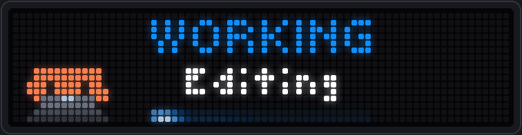
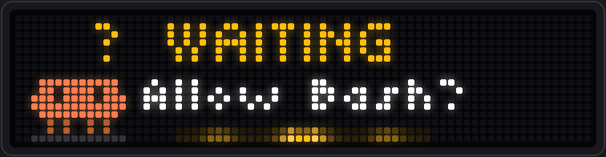
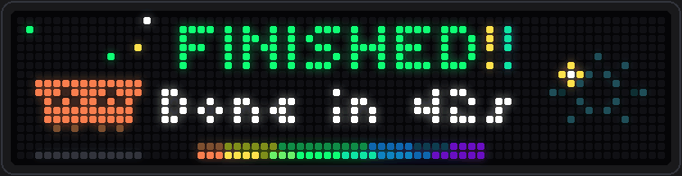

# Claude Code → BUSY Bar status plugin

An installable Claude Code plugin that mirrors Claude's lifecycle state on the
BUSY Bar front display. It uses Claude Code lifecycle hooks, shared per-plugin
state, and BUSY Bar's HTTP API. It does not add tools or prompt instructions,
so status changes consume no model tokens.



*The **WORKING** state on a real BUSY Bar (captured from the device, 2 s loop):
the mascot types behind a laptop, the subtitle names the tool Claude is using
right now, and a comet sweeps the bottom edge. The other states are described
under [Display layout](#display-layout).*



***WAITING**: Claude needs a permission or an answer. The subtitle says what
it is asking for, and the bar makes a short sound
(see [Waiting dots](#waiting-dots) and [Sounds](#sounds)).*



*Turn done: **FINISHED** with the turn time, a rainbow rail and fireworks
(see [Celebration](#celebration)).*

## What the official APIs support

BUSY Bar is an HTTP server. The same API is available through:

| Connection | API base URL | Authentication |
| --- | --- | --- |
| USB | `http://10.0.4.20/api` | None |
| Wi-Fi LAN | `http://DEVICE_IP/api` | Wi-Fi API password in `X-API-Token` |
| BUSY cloud | `https://api.busy.app/busybar` | BUSY account API token as `Authorization: Bearer …` |

Wi-Fi API access is disabled by default. Connect over USB, open
`http://10.0.4.20`, and enable HTTP API access on the Network tab before using
LAN access. The official Python library can browse `_http._tcp` mDNS instances
whose names start with `busybar-`, but its documentation notes that shipped
firmware may not advertise the service. This plugin therefore defaults to the
reliable USB address and accepts a configured LAN address.

The plugin sends `POST /display/draw` with a `text` title for the 72×16 RGB
front display, plus a looping `animation` element for the mascot; while working
it adds a white `text` subtitle and a second `animation` for the comet. Text and
`#RRGGBBAA` colors are documented display features. The animations are small
`.anim` files the plugin uploads to the bar once (see
[Display layout](#display-layout)); no companion application, Bluetooth pairing,
WebSocket, or custom firmware is required.

Claude Code plugins load hook configuration from `hooks/hooks.json`. Command
hooks receive event JSON on standard input, including `session_id`, and receive
`CLAUDE_PLUGIN_ROOT`, `CLAUDE_PLUGIN_DATA`, and configured plugin options in the
environment. This implementation uses those documented interfaces only.

## State behavior

| Claude Code event | Session state |
| --- | --- |
| `SessionStart` (startup, resume, clear, fork) | `READY` (open, waiting for a prompt) |
| `SessionStart` (compact) | unchanged (compaction is not a new session) |
| `UserPromptSubmit` | `WORKING` |
| ordinary `PreToolUse`, `PostToolUse` | `WORKING` |
| `PreCompact` | `WORKING`, subtitle `Compacting` |
| `PostCompact` | back to the state `PreCompact` interrupted: `WORKING` after a mid-turn compaction, `READY` / `FINISHED` after a manual or idle one |
| `PreToolUse` for `AskUserQuestion` or `ExitPlanMode` | `WAITING_FOR_INPUT` |
| `PermissionRequest`, `Elicitation`, relevant wait notifications | `WAITING_FOR_INPUT` |
| `ElicitationResult`, permission denial, resume notifications | `WORKING` |
| `PostToolUseFailure` | `WORKING` (a tool failure is not a terminal failure) |
| `Stop` | `FINISHED` |
| `StopFailure` with `error: rate_limit` | `LIMIT` (held up by a usage limit, shown as `LIMIT HIT`; Claude may resume on its own, which shows as `WORKING` again) |
| any other `StopFailure` | `ERROR` |
| `SessionEnd` | session removed; `IDLE` if no others remain |

Multiple sessions share an atomically locked state file under
`CLAUDE_PLUGIN_DATA`. The bar follows **attention**, not chatter. Among the
sessions that are mid-turn (`WORKING`, `WAITING_FOR_INPUT`, `LIMIT`), the one you
last attended to wins, and the bar shows that session's state, subtitle, mode
badge and turn time together. A session earns attention when:

- you open it or submit a prompt (`SessionStart`, `UserPromptSubmit`), or
- it starts needing you (it enters `WAITING_FOR_INPUT`).

Tool calls never move the bar, so two busy sessions do not take turns on the
screen. A background session that asks for permission surfaces over the one you
were watching, and the bar returns to your session when you prompt it again.
When a session finishes, whatever is still running surfaces.

When no session is mid-turn, the highest-priority resting state wins:

`ERROR` → `FINISHED` → `READY` → `IDLE`

(the most recently updated session breaks ties). Identical states are not
resent. Device I/O is performed in a detached process, so hook execution does
not wait on the network. A single lightweight reaper removes sessions that have
emitted no hook event for the configured stale timeout; this recovers from
terminal crashes and unclean Claude Code exits.

### Detection limits

The plugin only knows what Claude Code's hooks tell it, and a few moments have
no hook. It never uses timers to guess.

- **Permission answered.** No hook fires when you approve or deny a permission
  prompt, so `WAITING` clears on the next tool event (`PostToolUse` or
  `PreToolUse`), not at the moment you answer.
- **Interrupted turn.** `Stop` does not run when you interrupt with Esc, so the
  bar stays on `WORKING` until your next prompt or the stale-session timeout.
- **Crash or kill.** No `SessionEnd` arrives; the session is dropped after the
  stale-session timeout (one hour by default).
- **Idle reminder.** About a minute after a response finishes with no input,
  Claude Code sends an `idle_prompt` notification and the bar changes from
  `FINISHED` to `WAITING`. It does not do this while waiting out a usage limit
  or while a background agent is running.
- **Permission-mode changes.** No hook fires when you switch modes (Shift+Tab, or
  plan mode starting and ending). The badge updates on the next event that carries the
  mode (a prompt or any tool call), so a change made while the session is idle shows up
  late. `SessionStart`, notifications, `StopFailure` and compaction events do not carry it;
  the last known mode is kept for those, and a new session shows no badge until its first prompt.
- **Several sessions.** One bar shows one session at a time (the one you
  attended last, see above), so a background session that finishes while you
  work in another does not show `FINISHED` or play its sound.
- **Subagents and background work.** Their tool hooks arrive under the same
  session and move the subtitle, but there is no separate "background agent
  finished" state.

## Display layout

```text
x 0-15    mascot      16x16 looping animation, one per state
          text        centered on the whole display
            rows 1-5    WORKING          small font, state color (rows 6-10, centered, when alone)
            rows 8-11   Editing          tiny font, white (WORKING only; plan usage such as 5h15% 7d3% on READY, see step 5)
            rows 14-15  comet            32px wide under the text, x 20-51 (WORKING only)
x 55-71   rows 12-15 permission-mode badge, colored text (not shown in the default mode)
x 56-71   rows 0-11  fireworks (FINISHED only)
```

### Mascot

A pixel-art Claude (orange, blocky, eyes as cut-outs) reacts to the state:

| State | Animation |
| --- | --- |
| `WORKING` | sits behind a laptop typing, a glowing logo on the lid, ellipsis dots pulsing overhead |
| `WAITING_FOR_INPUT` | glances left and right, taps a foot, amber `?` bobbing; the label reads `WAITING` followed by animated dots (`.`, `..`, `...`) |
| `LIMIT` | worn out and sweating beside a running hourglass; `LIMIT HIT` with the reset time underneath when the error gives one |
| `FINISHED` | jumps twice in a shower of confetti, then waves with twinkling sparkles; the label flashes `!!`, a rainbow rail shimmers underneath and fireworks go off beside the text |
| `ERROR` | dizzy X eyes, shakes, red `!`, a puff of smoke; the subtitle names the failure |
| `READY` | waves hello, blinks, a `>_` prompt with a blinking cursor overhead |
| `IDLE` | asleep and breathing, dim, little z's drifting up; a night sky beside the text (see below) |

The art is drawn procedurally in `scripts/busybar_mascot.py` (sprite, eye styles,
and one frame builder per state), so it is easy to tweak; bump `MASCOT_VERSION`
afterwards. Set `MASCOT` to `false` to get the full-width text layout back.

### Subtitle and comet

The subtitle gives the detail. While `WORKING` it says what Claude is doing, derived from the
tool in `PreToolUse`: `Reading`, `Editing`, `Running`, `Searching`, `Browsing`, `Subagent`,
`Tool` (MCP), `Compacting`, `Working` (anything else), or `Thinking` (after a prompt or
session start and after a permission wait). `PostToolUse` keeps the previous subtitle.

While `WAITING` it says what Claude is waiting for:

| Event | Subtitle |
| --- | --- |
| permission prompt | `Allow Bash?`, `Allow Edit?`, ... (`Allow tool?` for MCP tools, `Approve?` when the tool name is too wide) |
| `AskUserQuestion` | `Question` |
| `ExitPlanMode` | `Plan ready` |
| MCP elicitation | `MCP input` |
| idle reminder, quota wait over | `Your turn` |
| agent needs input | `Needs you` |
| auto-resume stale | `Press Enter` |

`ERROR` names the failure from the `StopFailure` error type: `Overloaded`, `Auth failed`,
`Org blocked`, `On hold`, `Billing error`, `Bad input`, `Bad model`, `Server error` (`Server err`
if it does not fit), `Max tokens`, `Cloud creds`, or `API error` for anything else.

`FINISHED` says how long the turn took, measured from the prompt that started it and
including time spent waiting for you: `Done in 42s`, or just `1m 23s` / `12m 5s` when the
longer text would not fit.

While `LIMIT HIT` it says when the limit lifts, if the error message includes it (`Resets 3pm`,
`Resets 3:30pm`, `Back in 2h15m`), else `Rate limit`. The message format is not documented, so
that parsing is best effort and always falls back to the plain cause. Other states show the
label only. All subtitles are at most 40 px wide so they center like the title.

The comet is a glowing head that eases back and forth along a dim 32 px rail, trail
fading behind it, in the configured `WORKING` color
(`scripts/busybar_anim.py`, which also holds a pure-Python encoder for the bar's
`.anim` format). While waiting, the same slot shows an amber ripple instead: rings spreading
from the middle of the rail, a new one every second. Set `WORKING_ANIMATION` to `false` to skip
both.

Text is centered on the whole display. A label too wide to clear the mascot
(over about 8 characters in the title font) is centered in the 56px column
beside it instead, and one too wide for that column (about 11 characters) is
anchored at the column's left edge and scrolls rather than covering the mascot.

### Celebration


`FINISHED` is the screen that is meant to feel good. Four small assets play together:
the mascot's jump-and-confetti loop, the flashing `!!` (a 3×5 animation placed right
after the label and centered with it, like the waiting dots), a rainbow rail with a
highlight sweeping along it in the comet's slot, and fireworks bursting in the free area
to the right of the text (x 56-71, rows 0-11). Animation pixels are opaque, so each effect
lives in space no text uses. `WORKING_ANIMATION=false` turns the rail, the `!!` and the
fireworks off together with the other bottom animations.

### Night scene

`IDLE` (no session open) is the screen the bar rests on, so it is deliberately calm:
the sleeping mascot, the title in a cool slate blue, `No session` underneath in a dimmed
subtitle, a slow breathing glow along the bottom rail (a four second swell, brightest in
the middle), and a night sky in the free area on the right: a crescent moon, stars twinkling
at different speeds, and a shooting star streaking across every six seconds. It is the same
corner the fireworks use, and everything is dim on purpose. `WORKING_ANIMATION=false` turns the
glow and the sky off with the other bottom animations.

### Sounds

The bar has a speaker, so the two moments you most want to notice from across the room
make a short sound:

| When | Sound |
| --- | --- |
| The bar changes to `WAITING` (a permission, a question, plan approval, the idle reminder) | a two-note "ding-dong" |
| The bar changes to `FINISHED` after a turn that took at least 20 seconds | a bright rising chime |

A sound plays when the state *changes*, never on a redraw (a new subtitle or a mode change is
silent), and at most once every 3 seconds. Quick replies stay silent because the finished chime
needs a turn of at least `SOUND_MIN_SECONDS` (default 20). Set `SOUNDS` to `false` to turn all
sounds off.

The sounds are synthesized by `scripts/busybar_sound.py` (bell-like tones, pure Python) as
`.snd` files, which are raw 16-bit mono 44.1 kHz PCM, and uploaded once like the animations.
The device volume is a single global setting shared with the bar's other apps, so the plugin
never changes it. The sounds are quiet by construction instead (`GAIN` in the sound module is
the peak level, 25% of full scale); if they are still too loud or too soft, change the device
volume in its settings or edit `GAIN`. Playing is best effort and happens after the display is
updated: a failed upload or play is logged and never delays or breaks the visuals.

Audition them with `busybarctl sound waiting` and `busybarctl sound finished`; `demo` plays
them too.

### Permission-mode badge

Claude Code reports the session's permission mode in the hook input (`permission_mode`),
so the bar can show it as a short colored word in the bottom-right corner:

| Mode | Badge |
| --- | --- |
| Plan mode | `PLAN` (teal) |
| Accept edits | `EDIT` (blue) |
| Auto mode | `AUTO` (green) |
| Don't ask | `LOCK` (gray) |
| Bypass permissions | `RISK` (red) |
| Default ("Manual") | no badge |

The badge follows the session whose state the bar is showing and stays across state changes.
Changing it redraws only the word, so the mascot and comet keep animating. The words are four
letters (at most 17 px, so they start at x=55) to stay clear of the longest subtitle, and the
comet is a fixed 32 px, centered under the text, so it ends before the badge begins. Set
`MODE_BADGE` to `false` to turn the badge off. The tiny-font glyph widths needed to place it
are in `scripts/busybar_font.py`.

### Waiting dots


While Claude waits for input the label is followed by three dots that appear one
after another. Text cannot animate, so the dots are a tiny 5×1 looping animation
(`busybar_anim.dots_animation`) placed on the label's baseline one pixel after its
last letter, in the `WAITING` color. The label and dots are centered together as
one unit, which needs exact label widths: `scripts/busybar_font.py` holds the glyph
widths of the title font, measured from a real bar's framebuffer. If the label plus
dots would not fit, or the dots' asset could not be uploaded, the plain label is
shown. Set `WAITING_DOTS` to `false` to turn them off.

### Regenerating the picture

`docs/working.gif` is captured from a real bar: `tools/capture_screenshot.py`
draws the state, reads the front display's framebuffer back from
`GET /api/screen` for one animation loop, and renders the frames as LED pixels.
It needs [Pillow](https://pypi.org/project/pillow/) (the plugin itself needs only
the standard library):

```sh
python3 tools/capture_screenshot.py --url 10.0.4.20 --state WORKING --activity Editing --mode auto
```

`--state` takes any of the seven states. `tools/make_icon.py` renders the plugin
icon the same way.

### How it is drawn

All animations are uploaded once to the device as versioned assets
(`mascot-<state>-v<N>.anim`, `working-<hash>.anim`, 5-12 KB each) and then play
on the bar itself, with no process of ours running.

Redraws are incremental. The device merges draws by element id, so a tool call
that only changes the subtitle sends just the subtitle and neither the mascot
nor the comet restarts. A state change swaps the mascot's asset, sends the new
label, and erases whatever the new state does not use.

Design constraints learned from the device, all handled in
`scripts/busybar_status.py`:

- A missing asset is drawn as a magenta box, so an animation element is only
  drawn after its asset's presence (name and size) is confirmed through
  `GET /storage/list`. If an upload fails, the bar shows text only (layout
  unchanged) and retries after a minute.
- The device answers HTTP 508 when you re-upload an asset it is displaying, and
  removing an in-use asset can hang its web server. Assets are therefore
  immutable and versioned; the plugin never overwrites or removes them, so a
  color or art change leaves the old file behind (a few KB).
- Font and position constants sit at the top of the script; bump
  `LAYOUT_VERSION` after changing them.

## Requirements

- macOS (primary target), Linux or Windows (see
  [Linux and Windows](#linux-and-windows))
- Claude Code with plugin support and the hook events in `hooks/hooks.json`
- Python 3.9 or newer (the macOS `/usr/bin/python3` supplied by Xcode tools is
  sufficient)
- BUSY Bar with a current firmware/API

The runtime uses only Python's standard library. Installing `busylib` is not
required. The direct HTTP approach is the simplest reliable option here: the
official API is language-independent, each update is one small request, and it
avoids installing a package into Claude Code's runtime just to draw one text
element.

## Setup

Four steps, plus an optional fifth: install the plugin, connect the bar (USB or LAN),
tell the plugin where the bar is (LAN only), and check that it works.

### 1. Install the plugin

Put this folder in Claude Code's personal skills directory:

```sh
mkdir -p ~/.claude/skills
cp -R /path/to/busy-claude ~/.claude/skills/busy-claude
# or: git clone <repository-url> ~/.claude/skills/busy-claude
```

Claude Code loads every folder under `~/.claude/skills/` that has a
`.claude-plugin/plugin.json` as a plugin, enabled by default, with the id
`<manifest name>@skills-dir`: here `busy-claude@skills-dir`. Start a new Claude
Code session (or run `/reload-plugins` in an open one), then confirm:

```sh
claude plugin list          # busy-claude@skills-dir should be listed as enabled
```

and run `/hooks` inside Claude Code to see the plugin's hooks. If it is missing,
open `/plugin` and check the **Errors** tab. To uninstall, delete the folder.

To try it for one session without installing it, point Claude Code at the folder:

```sh
claude --plugin-dir /path/to/busy-claude
```

`claude plugin validate .` checks the manifest. It passes, with one warning
about the plugin name containing "claude"; that is cosmetic.

#### Linux and Windows

Development and real-device testing happened on macOS. Linux and Windows are
supported by the code (the Windows paths are covered by unit tests that mock the
Windows APIs) but have **not been run on real Linux or Windows machines**.

**Linux.** The install is the same as above (`~/.claude/skills/busy-claude`).
The plugin needs `python3` 3.9 or newer on `PATH` (the hooks run
`python3 .../busybar_status.py hook`) and nothing else: no pip packages. State is
kept in the plugin's data directory that Claude Code provides, or in the folder
named by `BUSYBAR_STATE_DIR`. Outside Claude Code (for example `busybarctl`)
with neither variable set, it uses `$XDG_CACHE_HOME/claude-busy-bar`, which is
`~/.cache/claude-busy-bar` by default.

The USB address `http://10.0.4.20` only works if your system brings up the bar's
USB network interface. If `./scripts/busybarctl check` cannot reach it, use the
[LAN option](#option-b-lan-wi-fi) instead; it needs no USB driver.

**Windows.** Native Windows works with Python 3.9 or newer and Claude Code
running on Windows itself:

1. Install the plugin into `%USERPROFILE%\.claude\skills\busy-claude`
   (for example `git clone <repository-url> "%USERPROFILE%\.claude\skills\busy-claude"`).
2. Make sure a **`python3` executable is on `PATH`**. The hooks run `python3`
   directly, without a shell, and Claude Code's hook format has no per-OS command,
   so `python3` must resolve to a real `.exe`. Python from the Microsoft Store
   provides `python3.exe`. The python.org installer provides `python.exe` and
   `py.exe` but usually not `python3.exe`: copy `python.exe` to `python3.exe` in
   the same folder, or put a `python3.exe` copy in a folder on `PATH`. Check with
   `python3 --version` in a new terminal. If it is missing, the hooks fail
   (Claude Code is not blocked, but the bar will not update).
3. Run the CLI helper as `scripts\busybarctl.cmd` instead of `./scripts/busybarctl`,
   for example `scripts\busybarctl.cmd check`.
4. State is kept in the plugin data directory Claude Code provides, or in
   `%LOCALAPPDATA%\claude-busy-bar` when you run the script outside Claude Code.
   `BUSYBAR_STATE_DIR` overrides both.
5. Whether the bar's USB network interface comes up on Windows depends on its
   driver. If `scripts\busybarctl.cmd check` cannot reach `10.0.4.20`, use the
   [LAN option](#option-b-lan-wi-fi).

On Windows the state lock uses `msvcrt.locking`, the background update and
reaper processes start detached from the hook (without a console window), and
hook input is read as UTF-8 regardless of the console code page.

WSL2 also works: run Claude Code inside WSL and follow the Linux steps, with the
plugin under the WSL home directory. The bar's USB network interface is attached
to Windows, not to WSL, so connect the bar over
[LAN](#option-b-lan-wi-fi) and use
`./scripts/busybarctl --url <bar-address> --auth wifi check`.

### 2. Connect the BUSY Bar

#### Option A: USB (default, nothing to configure)

1. Plug the BUSY Bar into your Mac with a USB-C cable.
2. The bar appears as a network device and answers at `http://10.0.4.20`. USB is
   treated as a secure channel, so there is no password.
3. Check the link:

   ```sh
   ./scripts/busybarctl check
   ```

   It prints the API version (for example `{"api_semver": "27.5.0"}`). The
   plugin's defaults already point at this address, so you can go straight to
   [step 4](#4-check-that-it-works).

The bar must stay connected. If it is unplugged, status updates are silently
dropped; Claude Code is never blocked or slowed by it.

#### Option B: LAN (Wi-Fi)

Use this when the bar is not plugged into the computer that runs Claude Code,
for example when it sits on a desk and is powered from a wall adapter.

1. **Join Wi-Fi.** Connect the bar to your network on the device
   (Settings → Wi-Fi).
2. **Enable API access, once, over USB.** Wi-Fi API access is off by default.
   Connect the bar by USB, open `http://10.0.4.20` in a browser, go to the
   **Network** tab, find the **HTTP API** section, turn on **HTTP API access**,
   then click **Set password and enable** and choose a password.
3. **Find the bar's IP address.** On the device: Settings → Wi-Fi → your network
   name → View IP Address. Give the bar a fixed address (a DHCP reservation in
   your router) so the setting does not go stale.
4. **Check the link** from the machine that runs Claude Code. Keep the password
   out of your shell history by passing it through the environment:

   ```sh
   export BUSYBAR_AUTH_TOKEN='your-api-password'
   ./scripts/busybarctl --url 192.168.1.20 --auth wifi check
   ```

   `--url` accepts a bare IP, a host name, or a full `http://IP/api` URL. A
   JSON version reply means it works; a timeout means the bar is not reachable
   (check the IP, and that both devices are on the same network); HTTP 403 means
   a wrong password.

The password is sent in the clear as an `X-API-Token` header over plain HTTP, so
only use LAN access on a network you trust. (A third mode, `cloud`, goes through
the BUSY cloud with an account API token; see the table at the top.)

### 3. Point the plugin at the bar (LAN only)

USB works with the defaults. For LAN, set the plugin's options in Claude Code:
run `/plugin`, open the **Installed** tab, select `busy-claude`, and choose
**Configure options**.

| Option | USB (default) | LAN |
| --- | --- | --- |
| Device URL | `http://10.0.4.20/api` | `http://192.168.1.20/api` (your bar's IP) |
| Authentication mode | `usb` | `wifi` |
| Authentication token | empty | the API password from step 2 |

The token is declared sensitive, so Claude Code masks it and keeps it in the
platform's secure credential store; it is never written to the plugin's state
file or committed anywhere. Closing the panel applies the change; if it does
not take effect, run `/reload-plugins`.

The same dialog has everything else you can change: enable or disable updates,
the request and stale-session timeouts, the label and `#RRGGBBAA` color of each
of the seven states, the subtitle color (default white), the mascot, the
working comet, the waiting dots, the permission-mode badge, the sounds and the finished-sound
threshold, and debug logging. Non-sensitive options also show up as rows in
`/config`. Debug logs go to `debug.log` under `CLAUDE_PLUGIN_DATA`; hooks never
print connection failures into the conversation.

Outside Claude Code (for the `busybarctl` helper, or as a fallback), the same
options are read from `BUSYBAR_DEVICE_URL`, `BUSYBAR_AUTH_MODE`,
`BUSYBAR_AUTH_TOKEN`, `BUSYBAR_MASCOT`, and so on: the option name, upper case,
with a `BUSYBAR_` prefix.

### 4. Check that it works

1. Run the demo. It walks through all seven states, five seconds each, and the
   first run uploads the animations to the bar:

   ```sh
   ./scripts/busybarctl demo
   ```

2. Start a new Claude Code session. The bar shows **READY** with the `>_`
   mascot. Send a prompt: it switches to **WORKING** with the typing mascot, the
   current tool as a subtitle, and the comet, as in the picture above.
3. Nothing happens? Turn on the **Debug logging** option, reproduce it, and read
   `debug.log`. The [troubleshooting](#troubleshooting) section covers the usual
   causes (unreachable bar, wrong password, a magenta box, missing animation).

### 5. Optional: plan usage on the READY screen

Claude Code's statusline receives data that hooks do not: your plan usage (the
5-hour and 7-day windows, Claude Pro and Max only), the model, the reasoning
effort and context-window usage. A plugin cannot set `statusLine` itself, so
this part is opt-in: you point your own `statusLine` at the plugin's wrapper,
which records the data and then runs your existing statusline command with the
same input, so what you see in the terminal does not change.

Add this to `~/.claude/settings.json`, replacing the text after `--next` with your
current `statusLine` command (leave `--next` out if you have none):

```json
{
  "statusLine": {
    "type": "command",
    "command": "python3 ~/.claude/skills/busy-claude/scripts/busybar_status.py statusline --next \"your-current-statusline-command\""
  }
}
```

On Windows use the full path to the script instead of `~`.

What it does:

- The `READY` screen (a session is open and waiting for its first prompt) shows
  plan usage as the subtitle, for example `5h15% 7d3%`: the share of each window
  used so far. A window whose reset time has passed is left out until fresh data
  arrives. The other screens are unchanged.
- The wrapper never draws on the bar. It only saves the data, and the next hook
  event shows it. Plan usage is account-wide, so the last value stays available
  across sessions.
- Per session it also stores the model, effort and context percentage. They are
  not drawn yet; `./scripts/busybarctl state` shows them under `meta`, and plan
  usage under `quota`.
- The statusline is not a plugin hook, so it does not get the plugin's data
  directory. The plugin writes the directory its hooks use to
  `hook-state-dir` in the default cache folder at every `SessionStart`, and the
  wrapper reads it from there. Set `BUSYBAR_STATE_DIR` for both if you want to
  choose it yourself.
- Claude Code skips a statusline until the folder is trusted, and plan usage
  only appears after the first response of a session.

## Test the real connection

The helper accepts a full URL or just a host/IP. Options must precede the
subcommand.

USB:

```sh
./scripts/busybarctl --url 10.0.4.20 --auth usb check
./scripts/busybarctl --url 10.0.4.20 --auth usb demo
```

Wi-Fi:

```sh
./scripts/busybarctl \
  --url http://192.168.1.20/api \
  --auth wifi \
  --token 'YOUR_API_PASSWORD' \
  check
```

Cloud:

```sh
./scripts/busybarctl \
  --url https://api.busy.app/busybar \
  --auth cloud \
  --token 'YOUR_BUSY_API_TOKEN' \
  check
```

Send one state, optionally overriding its appearance:

```sh
./scripts/busybarctl --url 10.0.4.20 send WORKING
./scripts/busybarctl --url 10.0.4.20 send WAITING_FOR_INPUT \
  --label 'YOUR TURN' --color '#FF8000FF'
./scripts/busybarctl --url 10.0.4.20 send WORKING --activity Editing
./scripts/busybarctl --url 10.0.4.20 assets   # install the animations and sounds if missing
./scripts/busybarctl --url 10.0.4.20 sound waiting   # or: finished
```

`demo` sends `WORKING`, `WAITING_FOR_INPUT` and `LIMIT` (each with a sample subtitle), `FINISHED`,
`ERROR`, `READY`, and `IDLE`, holding each for five seconds so the mascot can be seen.
The final state is neutral gray `IDLE`.

## Automated tests

```sh
python3 -m unittest discover -s tests -v
```

The suite uses a local mock HTTP server and covers lifecycle transitions,
interactive tools, non-terminal tool failures, API failures, disconnected
devices, stale cleanup, authentication headers, redraw deduplication, and two
simultaneous sessions.

## Real-device validation procedure

1. Update BUSY Bar firmware and connect it over USB.
2. Run `./scripts/busybarctl --url 10.0.4.20 check`; confirm it prints the API
   version response.
3. Run `demo`; verify the seven labels, colors and mascot animations on the front panel.
4. Start `claude --plugin-dir "$PWD"` and submit a prompt. Verify `WORKING`.
5. Ask Claude to perform several tool calls. Verify the display remains blue.
6. Trigger a permission request or `AskUserQuestion`. Verify yellow/orange
   `WAITING`.
7. Respond and let the tool finish. Verify `WORKING`, then green `FINISHED` at
   the end of the response.
8. Exit Claude Code. Verify neutral `IDLE`.
9. Disconnect the BUSY Bar and submit another prompt. Claude Code must continue
   normally. Reconnect it and trigger another lifecycle event.
10. Open two Claude Code sessions. Put one in a waiting state while the other is
    working; verify `WORKING` wins. Finish/end the working session and verify the
    waiting session becomes visible.

The automated behavior has been validated against a mock of the documented HTTP
contract. Physical rendering, device firmware compatibility, and LAN/cloud
credentials require the real-device checks above.

## Troubleshooting

**Connection refused or timed out**

- USB: confirm the device web UI opens at `http://10.0.4.20`.
- Wi-Fi: confirm HTTP API access is enabled and use the IP shown under
  Settings → Wi-Fi → your access point → View IP Address.
- Run `check` with the same URL/authentication values as the plugin.

**A magenta box appears where the mascot or comet should be**

The animation element points at an asset the device does not have (for example
after a factory reset). Run `busybarctl assets`; every state change also
re-checks and re-uploads what it needs.

**No sound**

Check the device volume (`curl http://10.0.4.20/api/audio/volume`), then run
`busybarctl sound waiting`. If that plays but real events do not, remember that FINISHED is
silent for turns shorter than `SOUND_MIN_SECONDS` and that sounds are rate limited to one
every 3 seconds. Enable debug logging and look for `played waiting` / `sound ... failed`.

**The bar shows text but no mascot or comet**

Enable debug logging and look for `animation asset failed`. Common causes are a
USB/Wi-Fi hiccup during the upload (retried after a minute) or
`MASCOT=false` / `WORKING_ANIMATION=false`.

**HTTP 403**

- Wi-Fi requires the configured API password in `X-API-Token`.
- Cloud requires a BUSY account token with BUSY Bar scope.
- Confirm `auth_mode` matches the connection type.

**Plugin loads but hooks do not run**

- Run `claude plugin validate --strict PATH_TO_PLUGIN`.
- Inspect `/plugin` → Errors and `/hooks` inside Claude Code.
- Run Claude Code with `--debug` and trigger a hook event.
- Confirm `python3 --version` is 3.9 or newer.

**The display does not immediately leave WAITING after permission approval**

This is the documented hook gap described under Detection limits. It changes on
the next post-tool event; the plugin does not use timers to guess that approval
occurred.

**The bar stays on WORKING after I interrupt with Esc**

Claude Code fires no hook when you interrupt a turn (`Stop` does not run for a
user interrupt), so nothing tells the plugin the turn ended. The bar corrects
itself on the next prompt or when the session goes stale.

**The bar remains stale after a crash**

Reduce the stale-session timeout option. The default is one hour to avoid expiring a
legitimate long-running tool. A clean `SessionEnd` updates immediately.

## References

- [BUSY Bar developer documentation](https://docs.busy.app/bar/dev)
- [BUSY Bar HTTP API guide](https://docs.busy.app/bar/dev/http-api)
- [Official busylib connection guide](https://busy-app.github.io/busylib-py/guides/connecting/)
- [Official busylib display guide](https://busy-app.github.io/busylib-py/guides/displays/)
- [Claude Code plugin documentation](https://code.claude.com/docs/en/plugins)
- [Claude Code hook reference](https://code.claude.com/docs/en/hooks)
